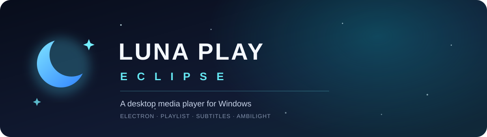
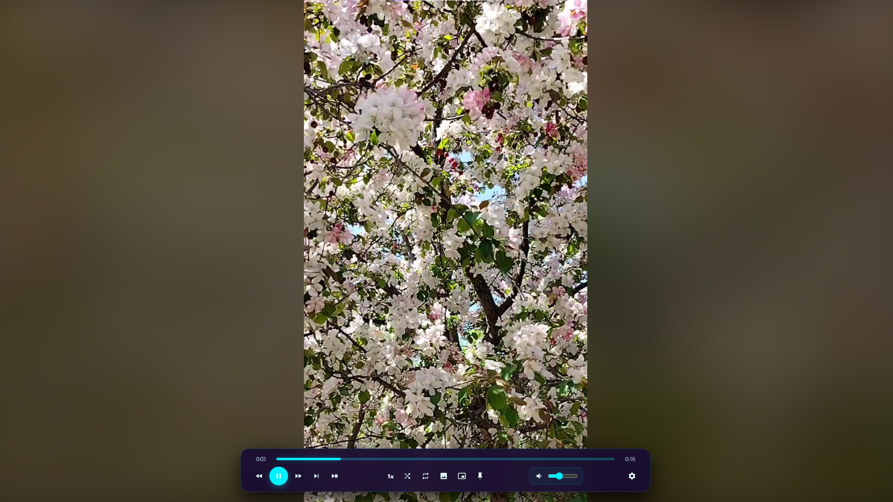
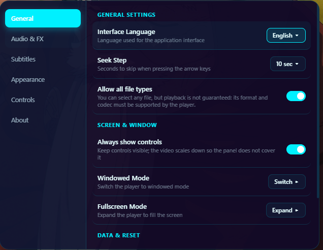
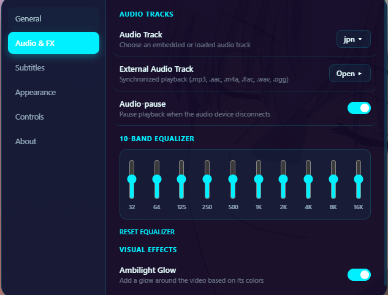
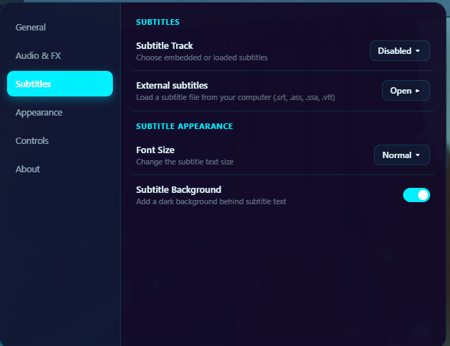
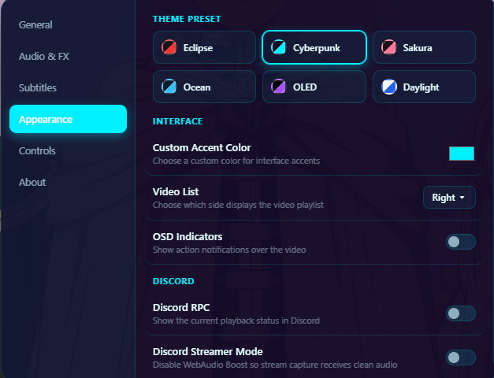
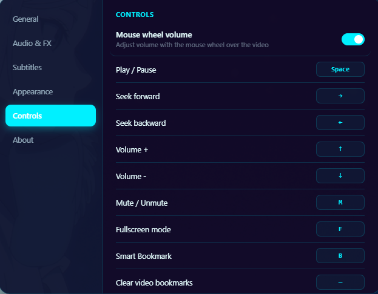
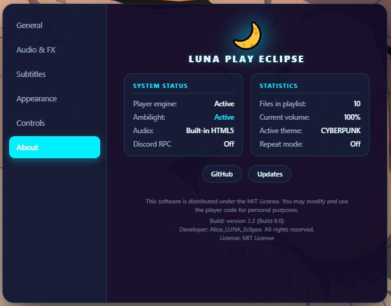

<div align="center">
  
  <br>
  <a href="README.md">Русский</a> · <a href="README.en.md">English</a>
  <br><br>
  <a href="https://github.com/Alice-LUNA-ECLIPSE/luna-play-eclipse/releases"></a>
  
  
  <a href="LICENSE.txt"></a>
</div>

<br>

**Luna Play Eclipse** is a Windows desktop media player with playlists, playback controls, and a customizable interface.

> Playback uses the codecs available in Chromium/Electron. Being able to select a file does not guarantee that its container, video codec, and audio codec can be played.

## Features

| Playback | Controls and appearance |
| --- | --- |
| Searchable, sortable, reorderable playlist | Playback speed, seek step, repeat, and shuffle |
| Embedded and external subtitles | Timeline bookmarks and screenshots |
| External audio tracks | Fullscreen and picture-in-picture |
| Equalizer and volume boost up to 300% | Themes, Russian and English interface |
| Optional Ambilight glow | Optional Discord Rich Presence |

## Скриншоты















## Download

Open [Releases](https://github.com/Alice-LUNA-ECLIPSE/luna-play-eclipse/releases), download the **Luna Play Engine Setup** installer from the latest stable release, and run the `.exe`.

The application does not currently install updates automatically. Download new versions from the Releases page.

## Run from source

Install Node.js and npm, then run:

```bash
git clone https://github.com/Alice-LUNA-ECLIPSE/luna-play-eclipse.git
cd luna-play-eclipse
npm ci
npm start
```

## Build the Windows installer

The project uses `electron-builder` with the NSIS target. The installer is written to `dist/`.

```bash
npm ci
npm run dist
```

The `build/icon.ico` file is required by the build and must be present in the repository.

## Formats and limitations

The file picker accepts common video and audio extensions, including MP4, MKV, AVI, WebM, MOV, MP3, FLAC, WAV, and OGG. This list describes selectable file types, not guaranteed playback support. Actual playback depends on the codecs available in the current Electron build. The project does not bundle a separate FFmpeg build.

`.mka` files usually contain audio only, so a black video area is expected. AVI and some MKV files may not play if their codecs are unavailable in Electron.

## Publishing releases

See [RELEASING.md](docs/RELEASING.md) for the versioning policy, release checklist, and release-notes template.

## License

Released under the [MIT License](LICENSE.txt).
