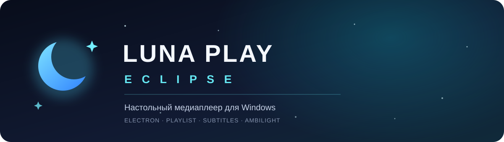

<div align="center">
  
  <br>
  <a href="README.md">Русский</a> · <a href="README.en.md">English</a>
  <br><br>
  <a href="https://github.com/Alice-LUNA-ECLIPSE/luna-play-eclipse/releases"></a>
  
  
  <a href="LICENSE.txt"></a>
</div>

<br>

**Luna Play Eclipse** — настольный медиаплеер для Windows с плейлистом, настройками воспроизведения и настраиваемым интерфейсом.

> Плеер использует встроенные возможности Chromium/Electron. Выбор файла не гарантирует его воспроизведение: поддержка зависит от контейнера, видеокодека и аудиокодека.

## Возможности

## 📸 Скриншоты
*(Загрузите сюда скриншоты вашего плеера)*
> Место для скриншота 1 (Главный экран)
> Место для скриншота 2 (Меню настроек "О ПО")

## Скачать

Откройте [раздел Releases](https://github.com/Alice-LUNA-ECLIPSE/luna-play-eclipse/releases) и скачайте установщик **Luna Play Engine Setup** с последнего стабильного выпуска. Запустите `.exe` и следуйте шагам установщика.

В приложении пока нет автоматической установки обновлений: новые версии нужно скачивать со страницы Releases.

## Запуск из исходного кода

Нужны Node.js и npm.

```bash
git clone https://github.com/Alice-LUNA-ECLIPSE/luna-play-eclipse.git
cd luna-play-eclipse
npm ci
npm start
```

## Сборка установщика Windows

Сборка настраивается через `electron-builder` и создаёт установщик NSIS в `dist/`.

```bash
npm ci
npm run dist
```

Файл `build/icon.ico` нужен для сборки и должен присутствовать в клоне репозитория.

## Форматы и ограничения

Плеер принимает распространённые расширения видео и аудио, включая MP4, MKV, AVI, WebM, MOV, MP3, FLAC, WAV и OGG. Это список типов файлов, которые можно выбрать, а не обещание, что каждый файл декодируется. Фактическое воспроизведение определяется поддержкой кодеков в текущей сборке Electron. Отдельный FFmpeg в проект не встроен.

Файлы `.mka` обычно содержат только аудио; для них чёрное видеоокно ожидаемо. AVI и некоторые варианты MKV могут не воспроизводиться, если используемый кодек недоступен в Electron.

## Публикация релизов

Пошаговая инструкция, правила версий и шаблон заметок находятся в [RELEASING.md](docs/RELEASING.md).

## Лицензия

Проект распространяется по лицензии [MIT](LICENSE.txt).
